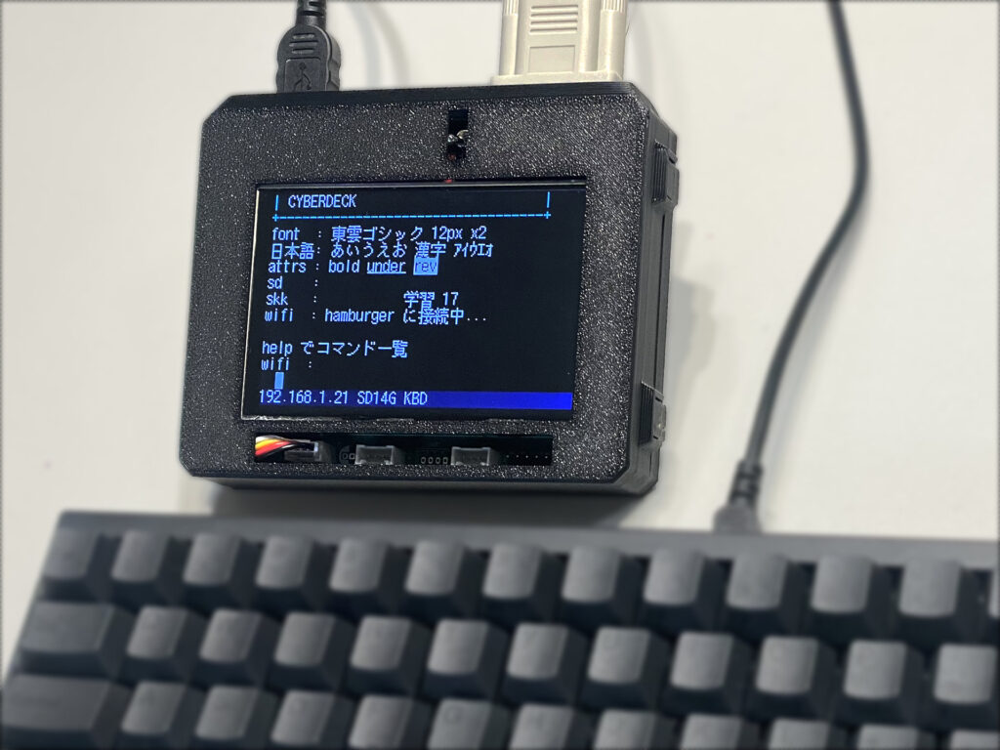
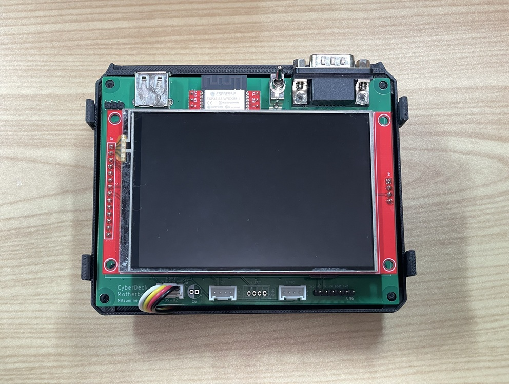
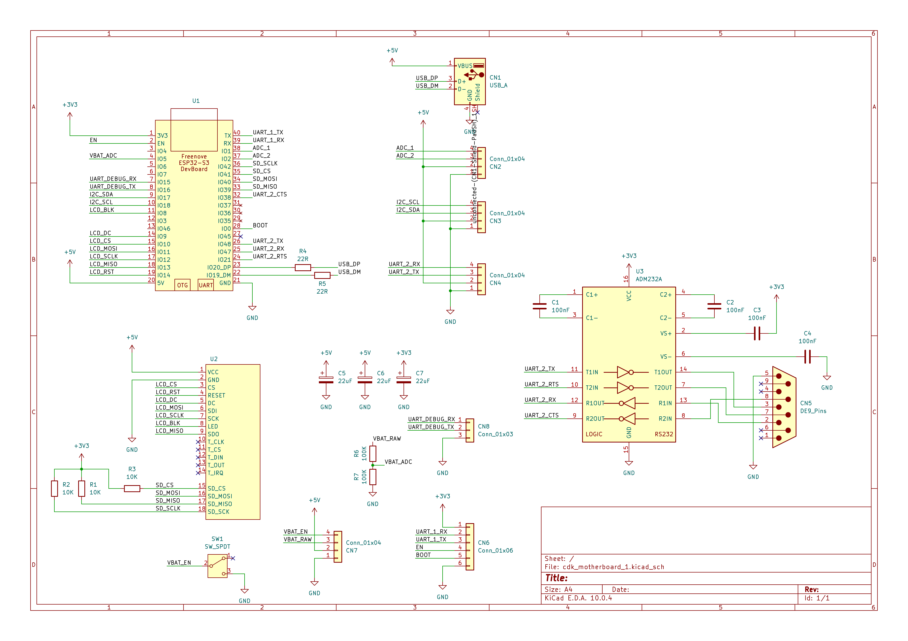

# CyberDeck — ESP32-S3 SSH 端末

ESP32-S3 で作る、日本語入力可能な SSH 端末です。USB キーボードで打ち、480x320 の SPI 液晶に VT 互換のターミナルを出します。Wi-Fi で SSH に入り、PC を開かずに作業できます。




想定している使い方:

- 手元の簡易な SSH 端末として
- SSH 先で動く AI エージェント（Claude Code / Codex CLI など）に指示を出す端末として
- マイコンならではの GPIO・I2C・UART を直接触れる端末として
- 日本語のテキストを書く道具として
- WebAssemblyでユーザーアプリを書いて、スタンドアロンの制御端末として

**A SSH terminal built on the ESP32-S3.** It connects to Wi-Fi, takes
input from a USB keyboard, and shows an 80x26 VT terminal on a
480x320 SPI LCD. You can log in to a remote host over SSH (PTY, public-key or
password auth) and copy files with `scp`, all without a PC. It also has
built-in SKK Japanese input, a text editor, a small shell with GPIO / I2C /
ADC / UART commands, microSD storage, and user apps written in WebAssembly
(C or Rust SDK). Firmware is ESP-IDF v5.5 in C11, and the KiCad data for the
motherboard is included. Documentation is mainly in Japanese.


## できること

- **SSH**（libssh2）: PTY 付きで `top` や全画面アプリが動く。公開鍵認証（実機で鍵を作る）と
  パスワード認証、`known_hosts` によるホスト鍵の確認、切れたときの自動再接続
- **`scp`**: この機械だけでファイルを送る・取る（Linux / Windows の OpenSSH 相手で確認）
- **ターミナル**: UTF-8・全角幅・SGR 色・スクロール領域など VT100/xterm の主要部分。
  スクロールバック 200 行
- **SKK 日本語入力**: SKK-JISYO.L（約 17.5 万語）をフラッシュに載せ、学習結果も残す
- **テキストエディタ**: `edit <file>` で microSD 上のファイルを日本語入力つきで編集
- **シェル**: 行編集つき。ファイル操作、`wget`（HTTP / HTTPS）、シリアル端末 `uart`、
  `gpio` / `adc` / `i2c` など
- **WebAssembly アプリ**: `wasm run` で microSD 上の `.wasm` を実行。
  ファームを焼き直さずに機能を足せる。SDK は C と Rust
  （コンソール・ファイル・GPIO・ADC・I2C・UART・TCP/UDP・TLS）
- **ステータス帯**: `set statusbar on`（再起動後）で、Wi-Fi・SSH・かな入力・SD・電池電圧などを
  画面下に出す（既定は出さない。出すと本文は 80 x 25）

使い方の詳細は [取扱説明書 (docs/MANUAL.md)](docs/MANUAL.md) にあります。

## ハードウェア

| | |
|---|---|
| MCU | ESP32-S3-WROOM-1-N16R8（16MB flash / 8MB octal PSRAM）。Freenove ESP32-S3 開発ボードをマザーボードに載せる |
| 表示 | 480x320 SPI 液晶（ILI9488）。東雲フォント 12px で 80 桁 x 26 行（2 倍表示で 40 x 13） |
| 入力 | USB キーボード（ESP32-S3 の USB-OTG をホストとして使用） |
| 記憶 | microSD |
| 外部端子 | D-sub 9 ピン（RS-232C）、Grove（GPIO / I2C / UART） |
| 電源 | 単3形 NiMH 電池 x2（本体では充電しない） |

マザーボードの KiCad データ（回路図・基板・プロジェクト内ライブラリ・JLCPCB 用ガーバー）は
[hardware/cdk_motherboard/](hardware/cdk_motherboard/) にあります。
ピン割り当てや設計判断は [HARDWARE_DESIGN.md](HARDWARE_DESIGN.md) を参照してください。

> **基板 v1 には既知の誤りがあります。** microSD の SPI 4 本（GPIO39〜42）は、回路図・基板データ上の
> 信号名が実物と違います。ファームウェアのピン指定（`cdk_board.h`）が正しい方です。
> 詳しくは [HARDWARE_DESIGN.md の「基板 v1 の既知の誤り」](HARDWARE_DESIGN.md#基板-v1-の既知の誤り) を見てください。

ファームウェアは試作機として使った **M5Stack CoreS3** 向けにもビルドできます
（`--board cores3`）。






## リポジトリの構成

```
cyberdeck_firmware/      ファームウェア（ESP-IDF プロジェクト）
  components/              ESP-IDF に依存しない純 C のコア（PC 上でもビルド・テストする）
  components_port/         ESP-IDF に依存する部分（表示・USB・SD・Wi-Fi・SSH など）
  main/                    起動とコマンド
  host/                    PC 上で回す単体テスト（ctest）
  tools/                   cdk.py（ビルド・書き込み・画面取得など）、フォント・辞書の変換
  wasm-sdk/                WebAssembly アプリの SDK（C / Rust）
  wasm-apps/               サンプルアプリ
  DESIGN.md                ファームウェアの設計書
hardware/cdk_motherboard/  マザーボードの KiCad データ
docs/MANUAL.md             取扱説明書
images/                    この README の写真と回路図
LICENSE                    MIT License
HARDWARE_DESIGN.md         ハードウェア仕様と検証の記録
ABOUT.md                   最初の企画（開発開始時の要求）
DEV_STATS.md               開発の統計
```

## ビルド

必要なもの:

- [ESP-IDF v5.5.5](https://docs.espressif.com/projects/esp-idf/en/v5.5.5/)
- PC 側のテストには clang、CMake、Ninja、Python 3
- `tools/cdk.py` は pyserial の入った Python で動かす（`export.ps1` の後の `python` でよい）
- `tools/gen_secrets.py` は git を使う（生成物が gitignore されているかを確かめるため）
- 開発は Windows（PowerShell）で行っています

### 1. 初回だけ: `secrets.h` を作る

ファームは `main/secrets.h` を読みます。これは Wi-Fi・SSH の初期値を入れるためのファイルで、
リポジトリには入っていません。リポジトリ直下に `.env` を作り、
`tools/gen_secrets.py` で生成してください。値は空のままでもかまいません
（起動後に `set wifi.ssid ...` などで設定でき、NVS に保存されます）。

```
TEST_WIFI_SSID=
TEST_WIFI_PSK=
TEST_SSHSERVER_HOST=
TEST_SSHSERVER_USERNAME=
TEST_SSHSERVER_PASSWORD=
```

```powershell
cd cyberdeck_firmware
python tools\gen_secrets.py
```

`.env` と `secrets.h` は gitignore 済みです。値をコミットしないでください。

### 2. ビルドと書き込み

```powershell
. <ESP-IDF のパス>\export.ps1
python tools\cdk.py build --board v1    # v1 = このリポジトリの基板。CoreS3 なら cores3
python tools\cdk.py flash
python tools\cdk.py selftest            # 起動 → 画面を取得して PC 側の基準画像と比較
```

`selftest` は PC 側で基準画像を描いて比べるので、先に下の「PC 上のテスト」で `build-host` を作っておいてください。
`--board` は最初の 1 回だけ付ければ、次からは省いても前回の基板を引き継ぎます。

v1 は書き込み・ログ用と制御用の 2 本のシリアルを使います。COM ポートの既定は開発機のもの
（v1: 書き込み・ログ COM76 / 制御 COM75）なので、違う場合は
`python tools\cdk.py --prog COM5 --log COM5 --ctrl COM6 flash` のようにサブコマンドの**前**に書くか、
環境変数 `CDK_PROG` / `CDK_LOG` / `CDK_CTRL` で指定します。
詳しくは [取扱説明書の 12 章](docs/MANUAL.md#12-ファームウェアを更新する) と
[cyberdeck_firmware/README.md](cyberdeck_firmware/README.md) を参照してください。

### SKK 辞書

辞書はリポジトリに含めていません。SKK-JISYO.L を取ってきて、別パーティションに書き込みます。

```powershell
curl -O https://skk-dev.github.io/dict/SKK-JISYO.L.unannotated.gz
# 展開してから
python tools\cdk.py dict SKK-JISYO.L.unannotated
```

### PC 上のテスト（実機不要）

```powershell
cd cyberdeck_firmware
cmake -S host -B build-host -G Ninja -DCMAKE_C_COMPILER=clang
cmake --build build-host
ctest --test-dir build-host --output-on-failure
```

VT パーサ、文字幅、フォント描画、SKK、シェル、WebAssembly の実行系などは
`components/` の純 C コードで、PC 上で検証できます。

## 開発について

このファームウェアは、AI エージェント（Claude Code）が実機でのビルド・書き込み・
画面の取得まで自分で回しながら開発しました。人間は方針の判断、配線や目視の確認などを
担当しています。その経過の数字（ビルド回数、不具合の数と見つけ方、人間が介入した回数など）を
[DEV_STATS.md](DEV_STATS.md) にまとめています。

設計の判断とその理由は [cyberdeck_firmware/DESIGN.md](cyberdeck_firmware/DESIGN.md) に残しています。

## ライセンス

[MIT License](LICENSE) © 2026 Mitsumine Suzu (verylowfreq)

同梱しているサードパーティのコードとデータは、それぞれのライセンスに従います。

| もの | 場所 | ライセンス |
|---|---|---|
| libssh2 1.11.1 | `cyberdeck_firmware/components_port/libssh2/upstream/` | BSD-3-Clause（`COPYING`） |
| wasm3（commit 2b4a5fa） | `cyberdeck_firmware/components_port/wasm3/upstream/` | MIT（`LICENSE`） |
| 東雲フォント（変換済みデータ） | `cyberdeck_firmware/components/cdk_font/shinonome12.cdkfont` | Public Domain |

ESP-IDF のコンポーネント（`esp_lcd_ili9488` など）はビルド時に取得され、リポジトリには含まれません。
SKK 辞書も含めていません。
